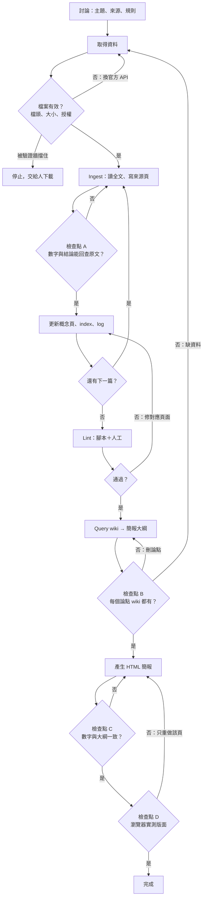

# Loop / Graph 設計與反思

對應作業步驟三、四。內容依 2026-11-24 的實際執行紀錄（`wiki/log.md`）整理。
反思部分是依紀錄寫的草稿，繳交前請用自己的話改寫。

## 一、流程圖

一句話版本：**取得資料 → 檢查檔案 → 逐篇 ingest → 回查原文 → lint → 查詢 wiki 寫大綱 → 大綱對照 wiki → 產生簡報 → 對照大綱 → 瀏覽器實測**。

## 二、哪些步驟會重複執行

| 迴圈 | 重複的單位 | 這次實際跑了幾輪 |
|---|---|---|
| 取得資料 | 每個檔案，直到有效或確定被擋 | 3 輪自動嘗試取得 5 篇；剩下 1 篇交給人手動下載後取得，共 6 篇 |
| Ingest | 每篇來源一次 | 6 次（第 6 次在簡報完成後才進行，連帶觸發下游更新） |
| Lint → 修正 | 直到 0 個問題 | 2 輪（第一輪 3 個問題） |
| 簡報 → 實測 → 修正 | 直到版面無溢出 | 2 輪（第一輪 1 頁溢出） |

## 三、哪些地方需要檢查或重新生成

| 檢查點 | 位置 | 檢查什麼 | 不合格時 |
|---|---|---|---|
| 檔案檢查 | 下載之後 | 檔頭是 `%PDF` 或 `<?xml`、大小合理、授權允許 | 換來源重抓；被擋就交給人 |
| A | 寫完來源頁之後 | 每個數字、結論在原文找得到；書目來自原檔 | 重寫該來源頁 |
| Lint | 每次 ingest 後、全部完成後 | 來源標記、連結、index、孤兒頁、缺來源的句子 | 修改對應頁面後重跑 |
| B | 大綱完成後 | 每個論點都對應到 wiki 頁 | 刪掉論點，或回去補資料 |
| C | HTML 完成後 | 數字、適用範圍、來源標註與大綱一致 | 重新生成該頁 |
| D | HTML 完成後 | 實際在瀏覽器逐頁量測是否溢出、能否翻頁 | 只重做有問題的那一頁 |

## 四、為什麼這樣設計

1. **錯誤越晚發現越貴。** 一個錯的數字若在來源頁就被擋下，只要改一行；若到了簡報才發現，要回頭改來源頁、概念頁、大綱、簡報四個地方。所以每個階段結束都設一個檢查點，而不是只在最後檢查成品。
2. **每一層只能引用上一層。** 簡報只能用大綱的內容，大綱只能用 wiki 的內容，wiki 只能用原文的內容。這樣每個檢查點都有明確的對照對象，檢查才做得下去。
3. **wiki 答不出來就說沒有。** 語言模型很容易用自己的背景知識把空缺補滿，而且讀起來很合理。規定「wiki 沒有就列為知識缺口」，才能確定簡報內容真的來自知識庫。
4. **重做的範圍要小。** 每個檢查點不合格時只退回一步、只重做有問題的那一頁，不整份重來。
5. **能用程式檢查的就不靠人眼。** 連結是否失效、來源代號是否存在、版面是否溢出，這些交給腳本；人力留給腳本做不到的，例如兩篇論文是否矛盾。

### 補充：晚到的來源如何處理

Hendon 2014 是在簡報做完之後才 ingest 的，等於實際測試了「wiki 更新後，下游要跟著改什麼」：

- 來源頁 → 水質概念頁 → 對照表 → 大綱 → 簡報第 9、10、13、15 頁，依序更新，再重跑 lint 與版面檢查。
- 因為每頁投影片下方都標了對應的 wiki 頁，所以很快就能找出哪幾頁受影響，不必整份重做。
- 核對後發現，先前依 Bratthäll 的轉述寫的內容**沒有錯，但不完整**：轉述略去了「計算在氣相中進行」「作者自己說需要實驗驗證」等但書。這證明「二手引用要標明」這條規則有實際作用——當時若把轉述當成原文，wiki 會把一個有但書的推論寫成確定的結論。

## 尚未完成的事

- 檢查點 D 以程式量測了全部 15 頁的版面溢出，並目視檢查了部分頁面的截圖，沒有逐頁目視全部。
- 簡報尚未在實際投影或其他瀏覽器上測試。
